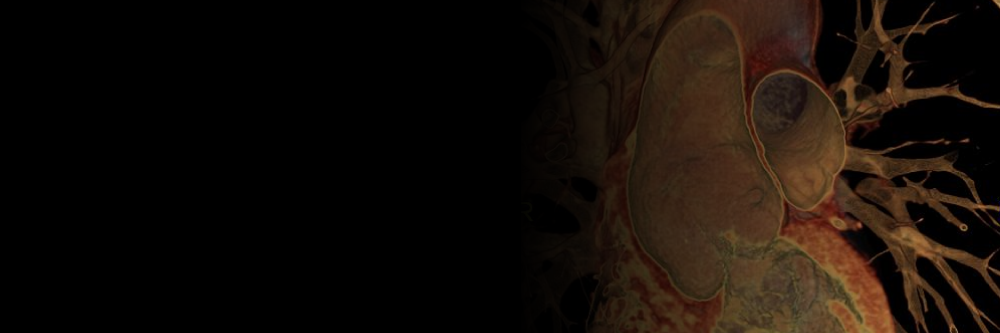

  <source media="(prefers-color-scheme: dark)" srcset="docs/banner_AD.png">
  
</picture>

## Malte ROLF, PhD
<i>(formerly Malte Rolf-Pissarczyk)</i>

Since March 2025, I have been a postdoctoral researcher at the [Institute of Applied Mechanics](https://www.ltm.tf.fau.de/) at Friedrich-Alexander-Universität Erlangen-Nürnberg, Germany, working within Prof. Ellen Kuhl's European Research Council Advanced Grant *DISCOVER*. I also continue to collaborate closely with the group of Prof. Gerhard A. Holzapfel at the [Institute of Biomechanics](https://www.biomech.tugraz.at/) at Graz University of Technology, Austria. This is where I completed my PhD in Biomedical Engineering with distinction in 2024, and I was fortunate to see my dissertation recognized with several national and international awards.

During my doctoral studies, I spent a year at the University of California, Berkeley, in 2016 and 2017 as a visiting researcher working with Prof. Panayiotis Papadopoulos, followed by a three-month research stay with Prof. Alison Marsden at Stanford University in 2022. Since then, I have remained connected to Stanford as a sponsored affiliate and currently return regularly for shorter visits to work with Prof. Ellen Kuhl.

### research interests

- Multiscale material modeling and model discovery for soft tissues
- Modeling and simulation of diseased arteries, especially aortopathies
- Growth and remodeling of arterial tissue and regenerative biomaterials
- Verification, validation, and uncertainty quantification of in silico models
- Surrogate-based uncertainty quantification with Bayesian inference

### more on my 🌐 website: [malterolf.github.io](https://malterolf.github.io)
